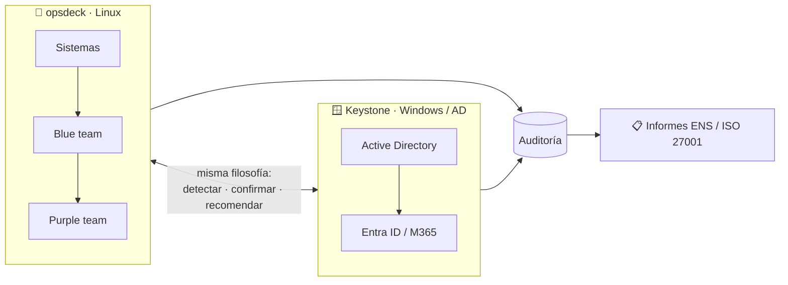

<!-- ═══════════════════════════════  CABECERA  ═══════════════════════════════ -->
<div align="center">


<a href="https://github.com/THRaven426">
  
</a>

<p>
  
  
  
  
</p>

</div>

---

## `$ cat /etc/motd`

```yaml
usuario:      Hari (THRaven426)
rol:          Administrador de sistemas · especializado en ciberseguridad
ubicación:    España 🇪🇸
enfoque:
  - Bastionado, detección y respuesta (blue team) + validación controlada (purple team)
  - Administración Linux y Windows Server / Active Directory
  - Automatización de tareas repetitivas: si lo hago dos veces, lo programo
  - Cumplimiento y buenas prácticas: ENS · ISO 27001
laboratorio:  HomeLab privado, solo con invitación
filosofía:    "Detecta, confirma, prioriza y recomienda."
```

<table>
<tr>
<td width="50%" valign="top">

### 🔭 Ahora mismo
- 🛡️ **opsdeck** → ya es **público**: de los informes de Nessus/OpenVAS a la re-verificación
- 🗝️ **Keystone** → validando contra un **AD real** (2019 / 2025) antes de la fase F1
- ⚙️ Firma de versiones con **GitHub Actions**

</td>
<td width="50%" valign="top">

### 💬 Pregúntame por
- 🐧 Linux, servicios, redes y firewall
- 🪟 Active Directory, GPO, permisos AD/NTFS
- 🔐 Hardening, auditoría y respuesta ante incidentes
- 🗄️ Bases de datos: MariaDB, MySQL, PostgreSQL, Oracle
- 🖥️ Hardware y montaje de servidores

</td>
</tr>
</table>

---

## 🧰 Stack

<div align="center">

**Sistemas e infraestructura**<br/>


**Automatización y desarrollo**<br/>


**Bases de datos**<br/>


**Ciberseguridad**<br/>


</div>

---

## 🚀 Proyectos destacados

<!-- PROYECTOS:INICIO -->

<!-- Sección generada por perfil/generar.py: edita perfil/proyectos.yml, no este bloque -->

<p align="center">
  
  
</p>

> [!NOTE]
> Algunos repositorios son **privados** (varios de forma temporal) mientras maduran.
> Si te interesa alguno, escríbeme y te cuento más o te doy acceso.

<table>
<tr>
<td width="50%" valign="top">

### 🛡️ <a href="https://github.com/THRaven426/opsdeck">opsdeck</a>
   

Sistemas y ciberseguridad para Linux en una sola herramienta: menú visual en la terminal o línea de comando.

- Administra equipos, los une a **Active Directory** y revisa su seguridad
- Auditoría de red, servicios expuestos, **TLS**, SSH, SMB y web
- Importa informes de **Nessus / OpenVAS** y re-verifica cada hallazgo
- Blue team: triaje, Lynis, ClamAV, rkhunter, AIDE
- 🚧 Barandilla de alcance y registro de todas las acciones

`Python` `Textual` `Bash`

</td>
<td width="50%" valign="top">

### 🗝️ Keystone
   

Gestión web centralizada de Active Directory y, próximamente, Entra ID / Microsoft 365.

- Asistente inicial: dominio, DC, LDAPS y cuenta de servicio con permisos verificados
- Login con cuentas del AD · roles = grupos, acotados por OU
- MFA y panel de estado de seguridad (ENS / ISO 27001)
- ⛓️ Auditoría encadenada por hash · actualizador con paquetes firmados

<sub>🔒 Repositorio privado: si te interesa, escríbeme y te doy acceso.</sub>

`Python` `FastAPI` `ldap3` `PostgreSQL` `PowerShell`

</td>
</tr>
<tr>
<td width="50%" valign="top">

### 🐧 linux-sk-tool


Navaja suiza en Bash para Ubuntu/Debian: instala servicios, actualiza el equipo y cambia la IP desde un menú interactivo.

<sub>🔒 Repositorio privado: si te interesa, escríbeme y te doy acceso.</sub>

`Bash` `Linux`

</td>
<td width="50%" valign="top">

### 🏕️ NafarKamp
   

Web para la gestión autónoma de bungalows en campings de Navarra: reservas, registro e intranet.

<sub>🔒 Repositorio privado: si te interesa, escríbeme y te doy acceso.</sub>

`PHP` `MySQL` `HTML/CSS` `JavaScript`

</td>
</tr>
<tr>
<td colspan="2" width="100%" valign="top">

### ⛽ <a href="https://home.harihomelab.net/surtidor">Surtidor</a>
 

Web para encontrar las gasolineras más baratas cerca de ti. Es el único servicio público de mi HomeLab.

🔗 **[home.harihomelab.net/surtidor](https://home.harihomelab.net/surtidor)**

<sub>Ahora mismo estoy haciendo cambios: puede que algo no funcione.</sub>

</td>
</tr>
</table>

<!-- PROYECTOS:FIN -->

<details>
<summary><b>🗺️ Cómo encajan opsdeck y Keystone</b></summary>
<br/>



</details>

---

## 🏠 HomeLab

<div align="center">

🔒 **Privado y solo con invitación.** Cerrado por defecto: nada es accesible desde fuera salvo lo que publico a propósito.<br/>
⛽ Única excepción pública: **[Surtidor](https://home.harihomelab.net/surtidor)**

</div>

---

## 📊 Estadísticas

<div align="center">


</div>

<!-- Serpiente de contribuciones: necesita .github/workflows/snake.yml en este mismo repositorio -->
<div align="center">
<picture>
  <source media="(prefers-color-scheme: dark)" srcset="https://raw.githubusercontent.com/THRaven426/THRaven426/output/github-snake-dark.svg"/>
  
</picture>
</div>

---

## 🤝 Conecta conmigo

<div align="center">

<a href="https://x.com/hari_m_g"></a>
<a href="https://instagram.com/hari.m.g"></a>
<a href="https://home.harihomelab.net/surtidor"></a>
<a href="https://github.com/THRaven426"></a>
<!-- <a href="https://www.linkedin.com/in/TU-USUARIO"></a> -->

<br/><br/>

> 🤝 Busco aportar en **cualquier cosa que sea útil para otros y para mí**.<br/>
> Todas las pruebas de seguridad se hacen solo en sistemas propios o con autorización por escrito.

</div>


